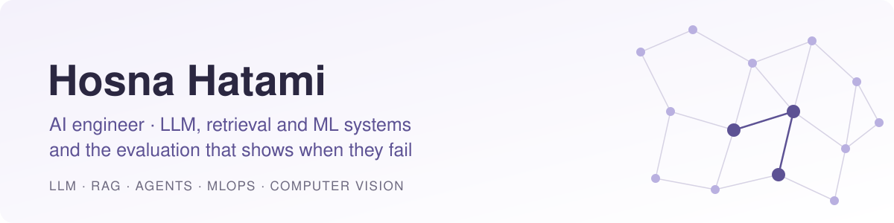

<picture>
  <source media="(prefers-color-scheme: dark)" srcset="assets/banner-dark.svg">
  
</picture>

  
  
  

Most AI demos only show the happy path. I build the other half: a hand-built test set, a simple baseline to beat, every number read from a committed results file, and an honest section on what didn't work.

## Featured projects

<table>
<tr>
<td width="50%" valign="top">

### [agentic-task-runner](https://github.com/hosnahatami04/agentic-task-runner)
ReAct agent written from scratch, plus a harness that breaks its tools on purpose.

**Task success holds at 71% with 10% tool faults, and drops to 54% at 30%.**

Agents · Ollama · fault injection · pytest

</td>
<td width="50%" valign="top">

### [technical-docs-rag](https://github.com/hosnahatami04/technical-docs-rag)
Answers questions on the PostgreSQL docs, and says "I don't know" when the answer isn't there.

**Caught 13 of 15 unanswerable questions; 92% of answer sentences backed by a source.**

Hybrid retrieval · BM25 + dense + RRF · grounding gates

</td>
</tr>
<tr>
<td width="50%" valign="top">

### [ml-drift-monitoring](https://github.com/hosnahatami04/ml-drift-monitoring)
Drift detectors written from scratch, alerting, and a harness that scores the monitor itself.

**Sudden drift caught in the first window on every test stream; 6.7% false alarms on drift-free streams.**

MLOps · KS / PSI / Page-Hinkley · Prometheus · FastAPI

</td>
<td width="50%" valign="top">

### [casting-defect-detection](https://github.com/hosnahatami04/casting-defect-detection)
Pass, reject or manual-review decisions for metal castings, set from the cost of each error.

**Zero escaped defects on the test set, 1.9% false rejects, 11.8 ms p95 on CPU.**

Computer vision · calibration · ONNX · cost-aware thresholds

</td>
</tr>
</table>

## More projects

| Project | What it does | Result |
|---|---|---|
| [ecommerce-recommender](https://github.com/hosnahatami04/ecommerce-recommender) | Popularity, ALS and a two-stage reranker on 2.7M real events | Only the two-stage model beats the popularity baseline on every headline metric |
| [multimodal-image-search](https://github.com/hosnahatami04/multimodal-image-search) | CLIP text-to-image search and BLIP visual QA, on CPU | Recall@10 of 0.569 on Flickr8k, with failures broken down by category |
| [crypto-volatility-forecasting](https://github.com/hosnahatami04/crypto-volatility-forecasting) | GARCH vs LSTM vs hybrid for next-24h volatility, walk-forward | GARCH beat both deep models on QLIKE; its edge over a 7-day mean was not significant |

## How these are built

**Every number is reproducible.** Results in a README come from a results file committed in the repo, written by a script you can run — not from a notebook that no longer executes.

**Baselines come first.** Each project is measured against something simple and obvious, and the README says plainly when the simple thing won.

**Failure is part of the spec.** Hard negatives, unanswerable questions, injected faults, drift-free control streams. A system that is never wrong has not been tested.

**Shipped, not just trained.** Pinned dependencies, a pytest suite, GitHub Actions CI and a Dockerfile in every repo. Decisions that aren't obvious are written down as ADRs.

## Stack

Python · PyTorch · Transformers · scikit-learn · FastAPI · Docker · GitHub Actions · Ollama · PostgreSQL

---

**Open to remote AI/ML roles and freelance projects.**
[hosnahatami04@gmail.com](mailto:hosnahatami04@gmail.com) · [LinkedIn](https://www.linkedin.com/in/hosna-hatami)
